# EmberMind — Wildfire Monitoring & Spread Forecasting System
# EmberMind — Yangın İzleme ve Yayılım Tahmin Sistemi

[](https://www.python.org/)
[](https://fastapi.tiangolo.com/)
[](https://celeryproject.org/)
[](https://www.postgresql.org/)
[](https://docs.docker.com/compose/)
[](LICENSE)

> **EN** — EmberMind turns satellite hotspots (NASA FIRMS), weather, topography and
> land-cover data into live fire events, Rothermel-based spread forecasts, threatened-asset
> exposure and risk alerts — streamed to an operator map over **WebSocket**, no page refresh.
>
> **TR** — EmberMind; uydu sıcak noktalarını (NASA FIRMS), hava durumu, topografya ve
> arazi örtüsü verilerini canlı yangın olaylarına, Rothermel tabanlı yayılım tahminlerine,
> tehdit altındaki varlık analizine ve risk uyarılarına dönüştürür — **WebSocket** ile
> operatör haritasına, sayfa yenilemeden akar.

---

## 🗺️ Architecture · Mimari

```mermaid
%%{init: {'theme':'base','themeVariables':{'primaryColor':'#ece7f7','primaryBorderColor':'#7e57c2','lineColor':'#7e57c2','clusterBkg':'#f6f3fc','clusterBorder':'#b39ddb','fontFamily':'Segoe UI, Arial'}}}%%
flowchart LR
    subgraph Ext["Data Sources · Veri Kaynakları"]
        FIRMS["NASA FIRMS"]
        OW["OpenWeather"]
        SRTM["USGS / SRTM"]
        COP["Copernicus CORINE"]
        OSM["Overpass / OSM"]
    end

    subgraph Async["Pipeline · Celery + Redis"]
        BEAT["beat scheduler"]
        WORK["workers · ingest → normalize → cluster"]
    end

    subgraph Engine["Analysis Services · Analiz"]
        SPREAD["spread (Rothermel + uncertainty + barriers)"]
        EXPO["exposure (T+dk, priority score)"]
        FWI["fire weather (FWI)"]
    end

    subgraph Api["FastAPI Web API"]
        REST["REST /api/v1/*"]
        WS["WebSocket /ws/live"]
    end

    PG[("PostgreSQL")]
    UI["Operator Map · Risk Panel · Inventory · /docs"]

    Ext --> Async --> PG
    PG --> Engine --> Api
    REST --> UI
    WS -->|live updates| UI
    UI -.->|manual events, imports| REST
```



> Full sequence & component diagrams: [docs/architecture/DIAGRAMS.md](docs/architecture/DIAGRAMS.md).

## ✨ Highlights · Öne Çıkanlar

| EN | TR |
|---|---|
| Satellite ingest with dedup & clustering | Uydu verisi alma, tekilleştirme ve kümeleme |
| Rothermel spread forecast + uncertainty envelope | Rothermel yayılım tahmini + belirsizlik zarfı |
| Threatened-asset exposure with `T+dk` first impact | `T+dk` ilk etki zamanıyla tehdit altındaki varlıklar |
| Fire Weather Index & risk alerts | Yangın Hava İndeksi (FWI) ve risk uyarıları |
| Live updates over WebSocket, auto-reconnect | WebSocket ile canlı güncelleme, otomatik yeniden bağlanma |
| Operator map, commander panel, resource inventory | Operatör haritası, komutan paneli, kaynak envanteri |
| Data-quality & governance monitoring | Veri kalitesi ve yönetişim izleme |

## 🚀 Quick Start · Hızlı Başlangıç

```bash
# EN/TR — copy env, then start the full stack (db, redis, api, celery, beat)
cp .env.example .env          # set FIRMS_API_KEY etc. / anahtarları girin
docker compose up -d --build
```

Open:

- **API docs · API dokümantasyonu** → http://localhost:8000/docs
- **Operator map · Operatör haritası** → http://localhost:8000/ui

<details>
<summary>Local / without Docker · Docker olmadan yerel</summary>

```bash
python -m venv .venv && source .venv/bin/activate   # Windows: .venv\Scripts\activate
pip install -r requirements-dev.txt
make dev                                            # uvicorn on 127.0.0.1:8000
make test                                           # pytest + coverage
make ci-check                                       # black + pylint + mypy + pytest
```
</details>

## 📁 Layout · Dizin Yapısı

```
src/
├── routes/     # FastAPI endpoints (REST + WebSocket)
├── services/   # business logic (spread, exposure, FWI, ingest…)
├── models/     # SQLAlchemy ORM
├── static/     # operator map, risk panel, inventory UI
└── config/     # settings per environment
scripts/        # migrations & demo helpers
tests/          # unit tests
docs/           # architecture, API and data-source docs
```

## 📚 Documentation · Dokümantasyon

- [API reference · API referansı](docs/api/README.md)
- [Architecture · Mimari](docs/architecture/README.md)
- [Diagrams · Diyagramlar](docs/architecture/DIAGRAMS.md)
- [Data sources · Veri kaynakları](docs/DATA_SOURCES.md)
- [Installation guide · Kurulum rehberi](docs/guides/INSTALLATION.md)

## 🤝 Contributing & License · Katkı ve Lisans

Contributions welcome — see [CONTRIBUTING.md](CONTRIBUTING.md). Released under the
[MIT License](LICENSE). · Katkılara açığız — bkz. [CONTRIBUTING.md](CONTRIBUTING.md).
[MIT Lisansı](LICENSE) altında yayınlanmıştır.

---

⭐ If this helps, star the repo! · Faydalı olduysa yıldız vermeyi unutmayın!
