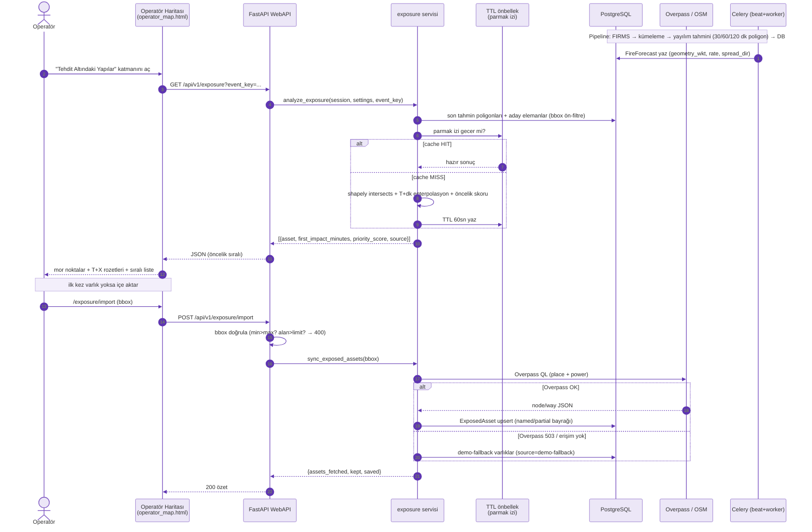
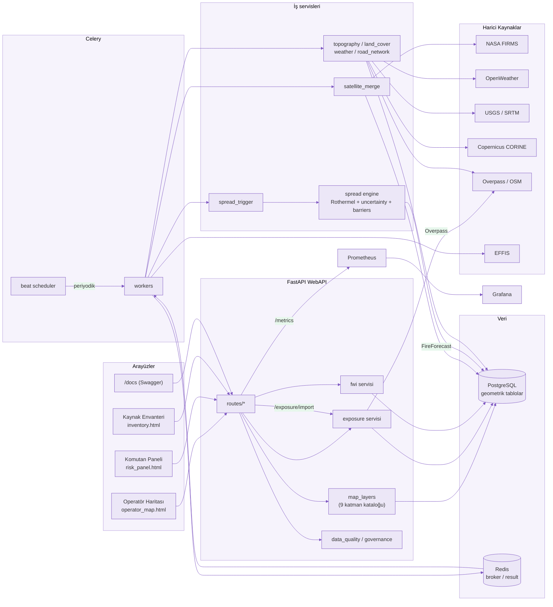

# EmberMind — Mimari Diyagramlar

Bu dosya, sistemin akışını referans görsellerdeki tarzda (lavanta temalı
**Mermaid** sequence ve bileşen diyagramları) anlatır. Qoder markdown
önizlemesi Mermaid'i doğal olarak çizer; harici olarak
[Mermaid Live Editor](https://mermaid.live)'e de yapıştırabilirsiniz.

> Not: EM-023 analiz önbelleği süreç-içi (in-process) bir parmak-izi/TTL
> önbelleğidir; Redis yalnızca Celery broker/result backend'i olarak kullanılır.

## 1. Sıra Diyagramı — Tehdit/Maruziyet Analizi (EM-023)

Yayılım tahmini poligonlarıyla yerleşim/yol/enerji hatlarını kesiştirip
enterpolasyonlu `T+dk` ilk-etki zamanı ve öncelik skoru üretme akışı.

## 2. Bileşen Diyagramı — Sistem Geneli

Katlama: arayüzler → FastAPI → Celery (zamanlama/işleme) → iş servisleri →
veri katmanı → harici kaynaklar → gözlemlenebilirlik.

